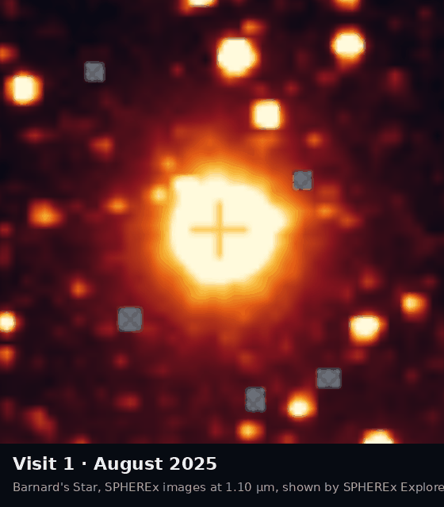

# SPHEREx Explorer

Type a name or coordinates, and watch what NASA's SPHEREx telescope saw there: a short movie of the infrared sky, visit after visit, with the spectrum of the object you point at. Things that move hop. Things that vary change color.

Project of team **Foxtrot Zulu Kilo Lima** for the 2026 NASA Space Apps Challenge, Montréal local event, November 14 and 15, 2026. Challenge: [Planet X and SPHEREx](https://www.spaceappschallenge.org/2026/challenges/planet-x-and-spherex/).

| | |
| --- | --- |
| **The tool** | https://fzkl-spaceapps-2026.pages.dev |
| **The sky map** | https://fzkl-spaceapps-2026.pages.dev/sky |
| **The demo, seven slides** | https://fzkl-spaceapps-2026.pages.dev/demo.pdf |
| **The service and its interactive documentation** | https://spherex-explorer-139331018511.us-east4.run.app/api/docs |
| **How the two talk** | [`docs/api-contract.md`](docs/api-contract.md) |
| **The plan and its reasons** | [`docs/architecture.md`](docs/architecture.md) |



The picture above is not a drawing: these are two SPHEREx images of Barnard's Star, one year apart, as the tool blinks them. The star moved by 10 arcseconds and the stars around it stayed put.

## Try it in one minute

| Open | And look for |
| --- | --- |
| [Barnard's Star](https://fzkl-spaceapps-2026.pages.dev/?target=barnard) | The fastest star of the sky hops by 10 arcseconds between the first visit and the last, while the stars around it stay put |
| [Epsilon Indi B](https://fzkl-spaceapps-2026.pages.dev/?target=epsindi) | The spectrum of a pair of brown dwarfs, measured on the fly: peaks near 1.3, 1.6, 2.1 and 4.0 micrometers, and deep bands where the water and the methane of their atmosphere absorb the light |
| [RW Aurigae](https://fzkl-spaceapps-2026.pages.dev/?target=rwaur) | A young star that varies: between the first visit and the third, its light near 5 micrometers falls by half while its light below 1.1 micrometer rises by half |
| [WISE 0855](https://fzkl-spaceapps-2026.pages.dev/?target=wise0855) | A cold world 7 light-years away that no single image shows. It moves by 8 arcseconds a year |
| [R Draconis](https://fzkl-spaceapps-2026.pages.dev/?target=rdra) | A giant variable star, too bright for SPHEREx: the tool gives no flux and says why, instead of showing a wrong number. It still tells that the star faded by half in a year, read on the halo of light around it |

These are the five test targets of the challenge. Any other place works the same way: type a name or coordinates.

## What the challenge asks, and where it stands

| The challenge asks for | In this project |
| --- | --- |
| Coordinates in, a flipbook of SPHEREx images out | Done. Images are grouped by detector and by visit, so that what changes on screen is the sky and not the wavelength |
| The five test targets | Done. They load at once from static files, even when the archive is slow |
| Easy to update with new data releases | Done. Nothing is copied ahead of time for other places: the service asks the archive for the exposures of a position each time, and the releases it searches are one setting |
| Use the 102 bands, the six detectors, and spectra on the fly | Done. One request measures an object in every exposure that covers it, from 0.75 to 5 micrometers: [`GET /api/spectrum`](docs/api-contract.md#get-apispectrum) |
| Add or subtract images taken at different dates | Done in the browser, with four buttons: Watch, Blink between two visits, Subtract one visit from another, and Average the frames of a visit, which brings out an object as faint as WISE 0855. Two visits can also be laid over each other or put side by side |
| Find what moves or varies | Beyond what was asked: the service finds it by itself. It follows every source of a field from visit to visit and lists the ones that moved or changed, with their speed, their distance when it can be measured, and a confidence. See [Candidates](docs/api-contract.md#candidates). It works for any place of the sky, and a panel shows the list. It also looks for a body of the outer solar system: one that swings by tens of arcseconds with the seasons, too far to be followed as a source. See [a body that swings](docs/api-contract.md#a-body-of-the-outer-solar-system-swings-with-the-seasons). A sixth target, synthetic and labeled as such, shows it at work: a made-up body drawn on real frames, which the service finds at its distance |
| A place to see what was found | Beyond what was asked: [a journal](docs/api-contract.md#the-journal) lists the 28 findings of our own checks. Each one says what the service measured, what catalogs say of it, and opens the tool there in one click. 2 of them are in no catalog we asked. A visitor who sees something odd frames it and shares it in one click: [a mark](docs/api-contract.md#marks-shared-by-visitors) is a place and a category, with nothing to write, so there is nothing to moderate |
| A tool a newcomer can use | Beyond what was asked: a welcome window, a sentence under each control, and [a guided tour in nine steps](https://fzkl-spaceapps-2026.pages.dev/sky?tour=1) that goes from the sky map to the tools. The visitor only presses Next, and the words of the mission are explained on the way |
| A map to choose where to look | Beyond what was asked: [the whole sky as SPHEREx sees it](https://fzkl-spaceapps-2026.pages.dev/sky), in the wavelengths of the all-sky cube the mission published in November 2026. Drag to move, scroll to zoom, slide through 99 wavelengths from 0.77 to 5 micrometers. A click on any place opens the explorer there, and the Back button returns to the same sky. The findings of the journal and the marks of visitors are pinned on it: a pin opens the explorer on its target, with its name and its motion |
| Coordinates in the URL, to embed the tool elsewhere | Done. The address of the page holds the target, a preset, a name or coordinates, and the view: detector, visit, mode |
| Adjustable field of view | Done. The service accepts any width from 0.02 to 0.5 degree, and the interface offers two: 0.1 and 0.3 degree |
| Metadata such as the contamination flags | Done. Each image shows its date, its wavelength, its detector, its visit and the quality of its measurement, and a switch tints the flagged pixels. See [the frame](docs/api-contract.md#the-frame) |
| Overlay catalogs of other telescopes | Done in the service: [`GET /api/catalog`](docs/api-contract.md#get-apicatalog) lists the sources of Gaia DR3 and of AllWISE inside a view, with their motion, so that a marker follows a fast star from frame to frame. The five test targets have that list in a static file. In the interface, the advanced tools draw the stars of Gaia over the image, where WISE saw them in 2010, and the path from then to now |

## What makes SPHEREx hard, and what we did about it

- **Two images in a row are not the same color.** SPHEREx has no filter wheel: the wavelength an object is seen at depends on where it falls on the detector, and changes at every exposure. A movie sorted by date alone flickers for no reason. The tool compares images of the same detector, visit against visit.
- **The interesting objects move.** Barnard's Star is more than 4 arcminutes from its catalog position of the year 2000. The service computes where a target was at the date of each exposure, and searches the archive there.
- **A file weighs 62 MB and a view needs 60 of them.** The service reads only the bytes it needs in the public files, about 1 percent of each: a few rows of pixels, their flags, and the headers.
- **Bright stars saturate, and the files say it two ways.** A pixel flagged as overflowing may only be near saturation and still hold a good value, or be truly saturated and hold none. The tool keeps the first and warns, and refuses to give a flux for the second. A saturated star is not lost for all that: its halo, far from the heart, still follows its brightness from one visit to the next.
- **The archive has bad minutes.** Its search fails in bursts of a few seconds. The service tries again, remembers what it learned, and tells the browser when to come back.

## What we checked

Nobody gave us the expected answer for the five targets, so each step was checked against something independent. The details are in [the contract](docs/api-contract.md#how-it-was-checked).

| Question | Answer |
| --- | --- |
| Are these the right pixels? | The pixels the service reads are identical to the cutout the archive makes of the same exposure |
| Is north up and east left? | Five 2MASS stars of the field of Barnard's Star are where the grid puts them, within half a pixel |
| Does the motion match? | The saturated heart of Barnard's Star moves by 3.4 pixels of the view between the first and the last visit. Its catalog proper motion predicts 3.7 |
| Is the flux right? | 8 steady stars compared with 2MASS and AllWISE in 38 pairs of star and band: the median of measured over catalog is 0.998 |
| Does another team measure the same spectrum? | SPIFF, a published library of SPHEREx spectra of brown dwarfs (Gagné et al. 2026), measures three of our objects another way and on another data release: Epsilon Indi B, Luhman 16 and LP 944-20. Over 297 bands from 0.74 to 5 micrometers, the median of ours over theirs is 1.016, and nine bands in ten agree within 10 percent |
| Is the uncertainty honest? | Exposures of a steady star differ by 1 to 3 percent, more than the files alone predict. The stated uncertainty includes it |
| Do two ways of measuring agree? | The 1,044 fluxes of the spectrum files equal those of the image files, exposure for exposure |
| Does it find what moves, with no position given? | 16 of the 17 nearby stars tried that move by more than 1 arcsecond, the three test targets among them, each with a speed within two sigma of its catalog. The one missed, Ross 128, is too bright and too slow. 32 quiet fields, 831 sources, give no candidate |
| What is the faintest it finds? | We added 2,560 made-up stars to the real frames of 32 quiet fields, one at a time, and ran the detection as the site runs it. A star seen by the six detectors that moves by 3 arcseconds per year is found six times in ten at 0.2 millijansky, magnitude 18, and nine times in ten from 0.3. A cold one, seen by the two reddest detectors only, is found three times in four at 1 millijansky, or at 0.5 when it moves by 8 arcseconds per year: the case of WISE 0855. Half of the speeds found are within 0.1 arcsecond per year of the true one. None of the 640 stars that did not move was claimed |
| Would it see a Planet X? | Between 1,600 and 24,000 astronomical units, if it is bright enough. The service follows a body through its swing with the seasons, tens of arcseconds wide, and reads its distance from it. No such body is known, so 1,344 made-up ones were hidden in the real frames of 32 quiet fields: 79 percent of those of 1 millijansky were found, and half of the distances are within 1 percent of the true one. The 74 real fields kept for tests, with nothing hidden, give none. WISE had found nothing as large as Saturn out to 10,000 astronomical units (Luhman 2014): this is a search anyone can run, not a promise |
| Does a place clicked on the sky map lead to the finding? | We gave the service the place of each test target as a visitor would click it: no name, no proper motion, 14 arcseconds off. It found the five by itself: Barnard's Star (10.5 arcseconds per year, catalog 10.39), Epsilon Indi B (4.63, catalog 4.68), WISE 0855 (7.34, catalog 8.15), RW Aurigae and R Draconis as changed. The first run of this test missed Barnard's Star. Where it saturates, a piece of the ring around its heart was taken for a source, and the three places of the star were split between two sources. Such a piece is no longer a source. The same correction made Kapteyn's Star clearer (8.8 ± 0.9 arcseconds per year, catalog 8.64), and changed nothing in the 56 other fields the search is checked on |
| Can it tell how far a moving object is? | For seven of them the swing with the seasons is measured, a twelfth to a thirtieth of a SPHEREx pixel, and gives the distance: Luhman 16 at 7.0 light-years for 6.5 in the catalog, Epsilon Indi B at 11.0 for 12.0, van Maanen's Star at 15.2 for 14.1 |
| Does it find a star that varies, unasked? | RW Aurigae, and more: pointed at a place of the Milky Way taken at random, it flags one star of 35, IRAS 18372-0002, a long-period variable known to SIMBAD, to the AAVSO and to Gaia. Toward the center of the Milky Way it flags three, one of them a variable of Gaia |
| Do other telescopes agree? | Moved to the date of the SPHEREx frames with its own motion, the source of Gaia DR3 falls 0.2 to 0.7 arcsecond from where we measure Barnard's Star, Epsilon Indi B, RW Aurigae and R Draconis: a tenth of a SPHEREx pixel. Gaia holds nothing at the place of WISE 0855, which is too cold for it. AllWISE saw that object in 2010, 126 arcseconds from where SPHEREx sees it now: 8.2 arcseconds per year, for 8.15 in the catalog |
| Can it follow a star too bright to be measured? | Through the halo of light around it. R Draconis saturates the six detectors, and its halo says it faded by half between June 2025 and June 2026: a Mira variable going from its maximum to its minimum. Checked blind on 16 saturated stars chosen before the run: five of eight known long-period variables were flagged, each change in the direction the AAVSO index predicts, and none of eight steady giants |
| How often is it wrong? | The one blind round, 21 fields chosen before the run, gave one false alarm in 16 quiet fields: a source cut by the edge of the view. Such positions are now refused. Every rule, and what it cost to find it, is in [the contract](docs/api-contract.md#how-it-was-checked) |

The service has 634 automated tests and the site 101. Every pull request runs them, and checks the 55 static files against the contract. One of those checks is that the made-up body of the synthetic target is found at the distance it was drawn at.

## How it works

```
Browser (TypeScript, React)            Service (Python, FastAPI, Cloud Run)         Public data
  movie, blink, difference    <---->     exposures of a position            <---->   IRSA image search
  spectrum chart                         images aligned on one grid         <---->   SPHEREx files on Amazon S3
  the view in the page address           flux of the target in each one     <---->   SIMBAD, for names
                                         what other telescopes know there   <---->   VizieR, for Gaia and AllWISE
        ^
        |  static files of the five test targets (Cloudflare Pages)
```

- **The browser** does everything interactive without a round trip: animation, contrast, blink, blend, difference, charts.
- **The service** answers nine calls: `health`, `resolve`, `exposures`, `frames`, `spectrum`, `candidates` and `catalog`, which only read, and the two of `journal`, to list the marks visitors shared and to share one. A mark is all it keeps: a place of the sky, a category chosen in a list, and the view it was made in. No account, no cookie, no name, no text, no address. What it remembers for an hour, lists of exposures and measured fields, only saves time.
- **The sky map** is a second page of the site. It draws the SPHEREx all-sky cube that IRSA serves, with Aladin Lite, the sky atlas engine of the CDS, loaded at one fixed version. The browser of the visitor asks IRSA for the images, and the sky server of ESA for the three skies it offers to compare. Nothing of it goes through our service: the map and the explorer do not depend on each other.
- **One grid per view.** Every image of a view is resampled on the same piece of sky, north up, so that pixel (x, y) is the same place in all of them. This is what lets the browser blink and subtract.
- **Speed.** The 62 images of one detector arrive in about 3 seconds. A spectrum over 250 to 550 exposures takes 6 to 11 seconds. The five test targets show at once.

## Run it

Requirements: Node 24, and [uv](https://docs.astral.sh/uv/) for the service.

```bash
# The site, on the five test targets, without the service
cd frontend
npm install
npm run dev

# The service, for any other place of the sky
cd backend
uv sync
uv run python -m uvicorn spherex_explorer.api.app:create_app --factory --reload
```

More in [`backend/README.md`](backend/README.md), [`samples/README.md`](samples/README.md) and [`docs/deployment.md`](docs/deployment.md).

## Repository

| Folder | Content | Owner |
| --- | --- | --- |
| [`frontend/`](frontend/) | The site | Nicolas |
| [`backend/`](backend/) | The service, its tests, and the command that builds the static files | Yirmeyan |
| [`samples/`](samples/README.md) | The static files of the five test targets, and the script that checks them | Yirmeyan |
| [`docs/`](docs/) | Contract, architecture, deployment, sources | Both |
| [`infra/`](infra/) | One-time setup of the hosting | Yirmeyan |

How we work together is in [`CONTRIBUTING.md`](CONTRIBUTING.md). The two AI agents of the team coordinate through [`docs/AGENT_BRIDGE.md`](docs/AGENT_BRIDGE.md), as [`AGENTS.md`](AGENTS.md) explains.

## Data and credits

- **SPHEREx.** This project makes use of data products from the Spectro-Photometer for the History of the Universe, Epoch of Reionization and Ices Explorer (SPHEREx), which is a joint project of the Jet Propulsion Laboratory and the California Institute of Technology, and is funded by the National Aeronautics and Space Administration. Data: SPHEREx Data Release 1 Spectral Images, [10.26131/IRSA678](https://doi.org/10.26131/IRSA678), and SPHEREx Quick Release Spectral Images QR3, [10.26131/IRSA662](https://doi.org/10.26131/IRSA662).
- **IRSA.** The data come from the NASA/IPAC Infrared Science Archive, which is funded by the National Aeronautics and Space Administration and operated by the California Institute of Technology. The files are read from the public bucket `nasa-irsa-spherex` of the Registry of Open Data on AWS.
- **SIMBAD and VizieR.** Names are turned into positions by the SIMBAD database, and the reference stars of our checks come from the VizieR catalog service, both operated at CDS, Strasbourg, France.
- **The sky map.** The all-sky images are the SPHEREx DR1 all-sky data cube, made by the SPHEREx Science Data Center and served by IRSA. They are drawn by Aladin Lite, developed at CDS, Strasbourg Observatory, France. The AllWISE, 2MASS and Digitized Sky Survey skies offered beside it are served by ESA Sky.
- **2MASS and WISE.** Our flux checks use the Two Micron All Sky Survey and the Wide-field Infrared Survey Explorer, both funded by the National Aeronautics and Space Administration.
- **Papers.** The mission: Bock et al. 2026, ApJ 999, 139. The pipeline: Akeson et al. 2026, ApJS 285, 67. The instrument: Korngut et al. 2026, arXiv:2603.29835.

Every source and dependency, with its license, is in [`docs/sources.md`](docs/sources.md).

## AI usage

The Space Apps rules ask teams to say how they used AI. Here it is, plainly.

- **Most of the code, the tests and the documentation of this repository were written by AI assistants directed by the team.** The service, the data pipeline, the static files and their checks were written with Claude, by Anthropic. The explorer page was written with Cursor Agent. The sky map page, the welcome window, the guided tour, the words of the interface and the last simplifications of the first screen were written with Claude.
- **The idea and the decisions are the team's.** The team chose the challenge and the idea, set the priorities (speed first, then a correct handling of SPHEREx, then the spectrum, then comfort), approved the architecture plan and every change to the contract, and decided what to build and what to drop.
- **Every scientific claim above comes from a check we can rerun,** not from what a model remembers: the tests of this repository, and the comparisons listed under "What we checked".
- **No image or video of the tool is generated.** Every picture it shows is SPHEREx data. The pictures of the demo slides and the animation at the top of this page are captures of the tool.
- **The demo slides and the texts of the submission were drafted with Claude and reviewed by the team.**
- **The same statement travels with the code.** It is in the description of the Python package, in the description of the service at [`/api/docs`](https://spherex-explorer-139331018511.us-east4.run.app/api/docs), and in a metadata tag of every page of the site.

## License

Copyright (C) 2026 the Foxtrot Zulu Kilo Lima team.

This program is free software: you can redistribute it and/or modify it under the terms of the GNU Affero General Public License as published by the Free Software Foundation, version 3. It is distributed without any warranty. See [LICENSE](LICENSE) for the full text.
