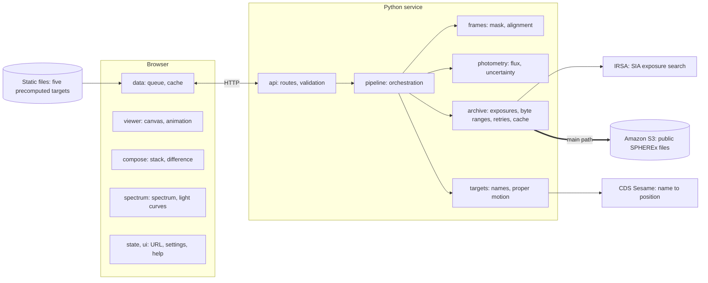

# Architecture plan

Approved on November 14, 2026 by Yirmeyan, before any code was written. Nicolas still has to confirm the ownership split.

## Guiding idea

A SPHEREx explorer that answers fast, that any curious person can use without background knowledge, that correctly shows what moves even though the wavelength changes from one exposure to the next, and that gives the spectrum of the object you point at.

Priorities, in the order we protect them: speed, correct handling of SPHEREx specifics, the spectrum, comfort of the interface.

## Summary

- **Browser (TypeScript, React).** Display, animation, contrast, stacking, difference, spectrum. Everything interactive reacts without a round trip to the server.
- **Python service (FastAPI).** It finds the exposures, reads only the pixels it needs, aligns them on a common north-up grid and measures the flux.
- **Pixel source.** The full SPHEREx files in the public Amazon S3 bucket, read by byte ranges. A fallback on the IRSA cutout service was planned and then dropped: see [Risks and fallbacks](#risks-and-fallbacks).
- **Unit of data: the frame.** One aligned exposure with its date, its wavelength and its flux measurement. The spectrum and catalog overlays build on it without restructuring.
- **Five precomputed targets.** The test targets of the challenge are served as static files, so they load at once even when the service is asleep.

## Overview



The browser talks only to the service and to the static site. Pixels always come from S3.

The path of one view, for an arbitrary position:

1. The user enters coordinates or a name. A name goes through `resolve`.
2. `exposures` returns the list of exposures.
3. The browser requests the frames of the default detector, several at a time.
4. For each frame, the service reads the header, computes the pixel window, reads the row bands it needs, aligns and measures.
5. Each frame is displayed as soon as it arrives. Animation, contrast and stacking then run without the service.
6. The other detectors load in the background and complete the spectrum.

For one of the five test targets, a single static file replaces steps 2 to 4.

## Measurements behind the design

Taken on November 14, 2026 from a home connection in Montréal, on Barnard's Star. Limits: one position only, and not from the deployed service, whose timings still have to be measured.

| Measurement | Result | Consequence |
| --- | --- | --- |
| Exposure search (IRSA SIA service) | 364 exposures in 1.6 s | One request per position, cached |
| Full IRSA cutout of one exposure | 3.97 MB in 2.7 s | Too heavy: 97% of the file is the PSF model, which the viewer does not need |
| IRSA cutout truncated after 92 kB | 0.5 to 0.7 s, with image, flags and variance readable | Good fallback path |
| IRSA cutouts in bursts | "Server busy, retry later" 2 times out of 14 in a row, 2 out of 8 in parallel | Do not depend on it during a weekend when hundreds of teams query the archive |
| DR1 and QR3 files on S3 | Public, no account, byte ranges accepted | Main path |
| One exposure read from S3, 0.1° field | 0.38 s and 1.4 MB for image, variance and flags | 7 short requests per exposure |
| One full detector, 62 exposures in parallel | 3.3 to 3.5 s | The default view fits in 5 s, search included |
| All six detectors, 364 exposures in parallel | 16 s | The full spectrum fills in the background |
| Compute per exposure (header, astrometry, 128 × 128 resampling) | 15 ms | The network is the bottleneck, not the compute |
| Alignment by local affine approximation | Maximum error of 0.02 pixel over 0.1° | No heavy reprojection library needed |
| Wavelength table | Identical across 3 exposures of detector 2, DR1 and QR3 | One 6 kB read per detector, then cached |
| Astropy fsspec reader on the same exposure | 0.8 to 7 s depending on the block size | We write our own byte-range reader |
| CDS Sesame name resolver | Position and proper motion of Barnard's Star in 1.5 s | Search by name without a database of our own |

### Layout of a SPHEREx level 2 file

Read from the S3 copies with byte-range requests. A file weighs 61 to 65 MB.

| HDU | Content | Size |
| --- | --- | --- |
| PRIMARY | Header only | 2,880 bytes |
| IMAGE | 2040 × 2040 float32, not compressed. Its header holds the spatial WCS | 16.6 MB |
| FLAGS | Bit mask, RICE compressed row by row | 7.7 to 11.1 MB |
| VARIANCE | 2040 × 2040 float32, not compressed | 16.6 MB |
| ZODI | Zodiacal light model, 2040 × 2040 float32, not compressed | 16.6 MB |
| EPSF | Point spread function models | 3.86 MB |
| WCS-WAVE | Wavelength lookup table | 5,760 bytes with its header |

IMAGE and VARIANCE are not compressed, so a band of rows is one contiguous byte range.

## Modules

Each module has a single reason to change, and dependencies go one way: `api` calls `pipeline`, and `pipeline` calls the others. `frames` and `photometry` depend on nothing but data.

Python service, in `backend/`:

| Module | Role | What never goes in it |
| --- | --- | --- |
| `api` | HTTP routes, input validation, response format, cache headers | Any computation |
| `pipeline` | Orchestrates one request: header from `archive`, pixel window from `frames`, bytes from `archive`, then alignment and measurement | Astronomy math, HTTP details |
| `archive` | Finds the exposures of a position. Reads the useful bytes of a file: headers, row bands, flags, wavelength table. Handles retries and rate limits | Scientific interpretation |
| `frames` | Pure functions that turn raw pixels into a frame: pixel window, mask, alignment on the common grid, wavelength, date | Network access |
| `photometry` | Pure functions that measure the flux and its uncertainty at one point of an exposure | HTTP, the archive |
| `targets` | Resolves a name and propagates a proper motion to a date. After the MVP: queries Gaia | Images |
| `config` | Reads settings from environment variables | Hard-coded values elsewhere |

Browser, in `frontend/src/`:

| Module | Role | What never goes in it |
| --- | --- | --- |
| `data` | Typed client of the service. Two interchangeable frame sources: static file or service. Queue and progressive loading | Display |
| `state` | State of the view, synchronized with the page URL | Pixel computation |
| `viewer` | Canvas drawing, stretch, color map, animation | Loading |
| `compose` | Pure functions: selection by band and by pass, stacking, difference, shift along a motion | Network, display |
| `spectrum` | Spectrum and light curve charts | Measurement: it plots what the frames carry |
| `ui` | Form, settings, the five targets in one click, help texts for newcomers | Scientific logic |

Three reasons behind this split:

- `archive` hides two readers behind one interface, S3 and IRSA. Changing the source touches nothing else. This is the Strategy pattern.
- `frames` and `photometry` make no network call. They are tested with a small real file kept in the repository, without the Internet.
- `compose` holds only pure functions: same inputs, same outputs. They are tested without a browser.

## Contract between the service and the browser

The contract is three calls and one unit of data, the frame. It is written in full in [`api-contract.md`](api-contract.md), which is the reference: this section is a summary. Every change to it goes through a pull request approved by the other teammate.

| Call | Response | Measured time | Cache |
| --- | --- | --- | --- |
| `GET /api/resolve?name=` | Position and proper motion of a named object | 1.5 s | 1 day |
| `GET /api/exposures?ra=&dec=` | The grid of the view and the exposures that cover the position: identifier, date, detector, pass, data release | 1.5 s, 3 s for a moving target | 1 hour |
| `GET /api/frames/{id}?ra=&dec=` | One frame | 0.4 s | 1 day while the pipeline changes, much longer once it is frozen |
| `GET /api/health` | Service status | Immediate | None |

After the MVP, `GET /api/catalog?ra=&dec=&radius=&epoch=` will return Gaia sources already moved to the requested date.

The main fields of a frame, with the values of the sample file:

```json
{
  "id": "dr1.2025W34_2B_0090_4D2.l2b-v27-2026-229",
  "time_mjd": 60908.982595,
  "wavelength_um": 1.1012,
  "bandwidth_um": 0.0254,
  "background": 0.4371,
  "noise": 0.1643,
  "target_xy": [63.35, 65.47],
  "photometry": { "flux_mjy": null, "error_mjy": null, "quality": "saturated" },
  "image": "base64 of 16-bit floats, MJy/sr, NaN = no value",
  "mask": "base64, one byte of flags per pixel"
}
```

Four rules:

1. **One grid per view.** All frames share the same center, the same size, north up and east left. The browser never realigns an image. Going from a sky position to a pixel is one short function, given in the contract, which is all a catalog overlay needs.
2. **Each frame carries its measurement.** Wavelength, date and flux arrive with the image. The spectrum is the chart of the frames already loaded, and so is the light curve. This is what lets us add the spectrum last without restructuring.
3. **Same format for precomputed data.** The static file of a target holds the list of exposures and its frames, in the exact format of the service. The browser has a single code path.
4. **No address supplied by the client.** The identifier of an exposure is checked against a strict pattern, and the service downloads only from the SPHEREx storage. Otherwise anyone could make it read an address of their choice.

For a moving object, the `frames` call also accepts a proper motion. The flux measurement then follows the object from one date to the next, while the image stays fixed on the sky so that the motion is visible.

Clicking another object recenters the view on it. Its spectrum arrives with its frames: one mechanism for everything.

## Speed

Six levers hold the first priority. The first three come from the measurements, the other three from the design.

1. **Read S3 by byte ranges.** 1.4 MB per exposure instead of 4 MB, and no "Server busy" refusal.
2. **One detector first.** The default view loads 62 exposures. The other five detectors follow in the background.
3. **Progressive display.** Each frame is shown as soon as it arrives. The first image appears after 2 seconds.
4. **Local interactivity.** Contrast, animation, stacking and difference are computed in the browser, on frames that are already aligned.
5. **Three levels of cache.** Static files for the five targets, HTTP cache for the frames, memory of the service for exposure lists and wavelength tables.
6. **Service close to the storage.** The files are in Northern Virginia, and so is the service.

| Situation | Target time | Basis |
| --- | --- | --- |
| One of the five test targets | About 1 s | Estimate: one static file of a few MB |
| Arbitrary position, first image | 2 s | Measured: 1.6 s of search, then 0.4 s for one frame |
| Arbitrary position, full default view | 5 s | Measured: 1.6 s of search, then 3.4 s for 62 exposures |
| Six detectors, full spectrum | 18 s from a laptop, under 10 s targeted from the service | Measured for the laptop, estimate for the service |
| Contrast, animation, stacking | Under 50 ms | Estimate: 62 images of 128 × 128 pixels |
| Service asleep | A few more seconds | Estimate |

Step S1 set the size of the grid and the precision of the numbers on the sample file: 128 × 128 pixels in 16-bit floats, 66 kB per frame and 31 kB once compressed.

## Hosting and tooling

The service is a plain container and the site is a folder of static files. Neither depends on a host, and either can move in an hour.

- **Service:** Google Cloud Run in the us-east4 region (Northern Virginia), next to the S3 bucket in us-east-1.
- **Site:** Cloudflare static hosting, with a preview URL for each pull request. GitHub Pages is the fallback.

Hosts considered for the service:

| Option | Decision |
| --- | --- |
| [Google Cloud Run](https://cloud.google.com/run/pricing) | Kept. A full CPU, scales to zero, monthly free tier of 180,000 vCPU-seconds, 360,000 GiB-seconds and 2 million requests |
| [Render free web service](https://render.com/docs/free) | Fallback. Spins down after 15 minutes without traffic and takes about a minute to wake up |
| [Hugging Face Spaces](https://huggingface.co/docs/hub/en/spaces-overview) | Dropped. Creating a Docker Space now requires a paid plan |
| [Vercel Hobby](https://vercel.com/kb/guide/commits-not-triggering-deployments) | Dropped. Only the account owner can trigger deployments, and two of us merge |

| Side | Tools | Why |
| --- | --- | --- |
| Service | Python 3.12, uv, FastAPI, httpx, NumPy, Astropy. Ruff and pytest | uv locks the versions: same environment on both our machines, in CI and in the container |
| Browser | TypeScript, Vite, React. Biome and Vitest | The types mirror the contract: a wrong field shows at compile time, not in front of the user |
| Both | One `Dockerfile`, one `.env.example`, environment variables for every setting | No secret and no address hard-coded |

CI and deployment follow three rules:

- **On every pull request.** Service: Ruff, then pytest without network. Browser: Biome, type check, Vitest, build. This check becomes required on `main`.
- **Network tests on demand.** The tests against S3 and IRSA do not run on every pull request. A slow archive must not block our work.
- **On every merge to `main`.** The site and the service are rebuilt and published from the repository, with no secret stored in GitHub.

## Steps

The MVP has 17 steps. Each one is a short branch, a pull request and a validation test, error handling included. The two tracks move in parallel as soon as the sample file of step S1 exists.

| Step | Owner | Deliverable | Validation test |
| --- | --- | --- | --- |
| S0 | Both | `backend/` and `frontend/` skeletons, green CI, an empty page and an `/api/health` deployed | Both public addresses answer |
| S1 | Yirmeyan | Contract written in `docs/api-contract.md` and a real sample file: Barnard's Star, detector 2 | Nicolas displays it at step F1 |
| B1 | Yirmeyan | `exposures`: the exposures of a position | Barnard's Star: at least 364 exposures, 6 detectors, 3 passes |
| B2 | Yirmeyan | S3 byte-range reader: image, variance, flags and wavelength of one exposure | Pixels identical to the IRSA cutout of the same exposure |
| B3 | Yirmeyan | Frame: mask and alignment on the common grid | Barnard's Star within 0.3 pixel of its predicted position. North up checked on a neighboring star |
| B4 | Yirmeyan | Photometry: aperture flux and uncertainty | Spectrum of an unsaturated star of the field, with no jump from one detector to the next |
| B5 | Yirmeyan | `resolve` and proper motion propagation | "Barnard's Star" gives the 2026 position, within 0.3 pixel of the measured star |
| B6 | Yirmeyan | Script that precomputes the five targets | Five files in the contract format, each displayed by the browser |
| B7 | Yirmeyan | Robustness: retries, exposure lists remembered and reused when the archive fails, clear error messages | With the exposure search cut on purpose, a position already asked still answers |
| F1 | Nicolas | Viewer: frames of the sample, asinh stretch, common limits | Barnard's Star visible, same contrast from one image to the next |
| F2 | Nicolas | Animation, selection by pass and by band | Barnard's Star jumps by about 2 pixels of the grid, 1 SPHEREx pixel, between two passes |
| F3 | Nicolas | Entry by coordinates or by name, progressive loading, waiting and error states | WISE 0855 loaded from its coordinates |
| F4 | Nicolas | Composition: stacking, difference, motion tracking | WISE 0855 searched in the stack of detector 6. The object is at the detection limit, so the result is uncertain |
| F5 | Nicolas | State of the view in the page URL, metadata panel | A copied link reopens exactly the same view |
| F6 | Nicolas | Spectrum and light curve | Spectrum shown for one target. R Draconis changes brightness from one pass to the next, if it is not saturated |
| F7 | Nicolas | Default settings, the five targets in one click, help texts | An outsider sees Barnard's Star move without any explanation |
| P1 | Both | README, sources and licenses, AI disclosure, 7 slides or a 30 second video, submission form | Every link opens without signing in |

After the MVP come B8, the Gaia catalog on the service side, then F8, its overlay in the viewer.

Five milestones, in Montréal time:

1. **Saturday 12:00.** S0, S1, B1 and F1 merged: the sample is displayed, CI is green, both addresses are online.
2. **Saturday 20:00.** An arbitrary position works end to end: B2, B3, F2, F3.
3. **Sunday 12:00.** Composition, spectrum and the five precomputed targets: B4 to B6, F4 to F6.
4. **Sunday 15:00.** B7 and F7 merged, then feature freeze. After that, fixes only.
5. **Sunday 20:00.** Submission sent, four hours before the 23:59 deadline.

## Ownership

| Who | Owns | Why |
| --- | --- | --- |
| Yirmeyan | All of `backend/`, the precompute script, the deployment of the service | Python is his working language, and the signal processing lives there: data reading, alignment, photometry |
| Nicolas | All of `frontend/`, the deployment of the site | The viewer is a self-contained block. It starts on the sample file, without waiting for the service |
| Both | The contract, CI, the submission | Every change to the contract is approved by the other before merging |

Three rules to work as two without blocking each other:

- **One owner per folder.** Nobody changes the other's folder without telling him.
- **The sample first.** The sample file of S1 is the first thing delivered. It decouples the two tracks for all of Saturday.
- **A 15 minute sync at each milestone.** We check together that the end to end path holds, and we decide what to cut if a milestone slips.

The `compose` module is signal processing written in TypeScript, on Nicolas's side. Proposal: Nicolas codes it, Yirmeyan writes its formulas and its test cases.

## Risks and fallbacks

The main risk is the archive itself during the weekend. The plan depends on it for one request per position only.

| Risk | Fallback |
| --- | --- |
| IRSA slows down or refuses the exposure search | Spaced retries. The service remembers each list for an hour, and gives a list up to a day old when the archive does not answer. The lists of the five targets are shipped in the static files |
| S3 becomes unreachable or its layout changes | Not covered by a second source. Decision of November 14: that day S3 answered every one of several thousand reads, while IRSA failed in three ways (bursts of HTTP 502 on the exposure search, cutouts answering 503, catalog queries left unanswered). A fallback on IRSA cutouts would lean on the less reliable of the two. Reads are retried, a file whose layout is not the expected one is refused with an error, and the five targets stay served by the static site |
| The flags are compressed row by row, and reading them partially turns out harder than planned | Mask taken from empty pixels, and rejection of outliers from one exposure to the next |
| The service sleeps or fails during the judging, which spans several weeks | The five targets stay served by the static site. A clear message explains the wait for the rest |
| WISE 0855 stays invisible even when stacked | Say so honestly in the tool. Barnard's Star and Epsilon Indi B carry the motion demonstration |
| A motion smaller than one pixel is hard to see | Grid finer than the native pixel, difference image, marker of the predicted position |
| A milestone slips | Cut in the agreed order: comfort first, with F7 reduced to the default settings, then the spectrum, F6. Never speed or the correct handling of exposures |
| Generated code is merged without review | The required CI and the validation test of each step are the safety net |

S3 also accepts direct requests from a browser. This is a way out if no host fits, at the cost of astrometry rewritten in TypeScript.

## Sources

- SPHEREx data: NASA/IPAC Infrared Science Archive (IRSA), https://irsa.ipac.caltech.edu/Missions/spherex.html
- SPHEREx files on Amazon S3: IRSA cloud data access, https://irsa.ipac.caltech.edu/cloud_access/
- IRSA SPHEREx tutorials: https://caltech-ipac.github.io/irsa-tutorials/spherex/
- CDS Sesame name resolver, Strasbourg astronomical Data Center: https://cds.unistra.fr/cgi-bin/nph-sesame
- WiseView, the reference tool for WISE: http://byw.tools/wiseview
- Hosting facts: the pages linked in the hosting table, read on November 14, 2026.

The license of each dependency is recorded when the dependency is added.
